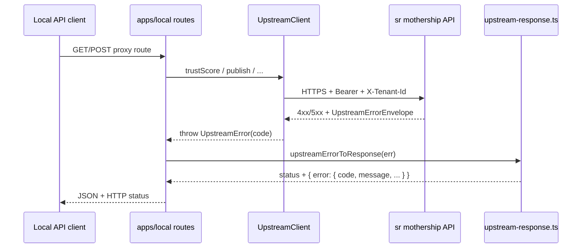

# Flow: upstream error → local HTTP response

## Diagram

## Cross-repo and trust boundaries

- **Wire taxonomy** is owned by `@skillsregistry/contracts` (`UpstreamErrorSchema`, `UpstreamErrorCode` in `packages/contracts/src/upstream.ts`).
- **Mothership** (`cogniumhq/sr`) emits the JSON envelope on failures; local node must not invent divergent `code` strings.
- **Local mapping** (`apps/local/src/http/upstream-response.ts`) is the single table used by `routes/public.ts` and `routes/admin.ts`. Deliberate choice: mothership `unauthenticated` / `forbidden` map to **502**, not 401/403, so callers are not blamed for the node's mothership API key or plan limits.

## E2E harness design

| Level | Execution | Fixtures |
|-------|-----------|----------|
| L1 | Zod parse of sample envelopes | `schemas.test.ts` — `UpstreamErrorSchema` |
| L2 | Pure functions + `UpstreamError` instances | `apps/local/src/http/upstream-response.test.ts` |
| L3 | Full Hono route with mocked `UpstreamClient` | Future: extend `public.test.ts` / `admin.test.ts` per route |

Mocks: construct `UpstreamError` directly (no network). Assert `status`, `body.error.code`, and optional `retry_after` / `request_id`.

## Ranked risks

1. **Auth semantics leak** — mapping `unauthenticated` to 401 would tell external callers their credential failed when the fault is the node's mothership key.
2. **Budget blindness** — `budget_exhausted` must stay **402** with structured `code` so operators upgrade plan rather than retry blindly.
3. **Rate-limit retry storms** — `rate_limited` must surface `retry_after` in the JSON body.
4. **Sandbox operator confusion** — `sandbox_contract_violated` must remain a named code at **502**, not generic 503.
5. **Envelope drift** — body must match `UpstreamErrorResponseBody` (snake_case optional fields on wire).

## Test cases

| ID | Title | Risk | Level | Preconditions | Input | Expected assertion | Status |
|----|-------|------|-------|---------------|-------|-------------------|--------|
| TA-upstream-error-http-map-1 | Full code→status table coverage | Drift between routes | L2-hermetic-e2e | `UPSTREAM_ERROR_STATUS` exported | Each `UpstreamErrorCode` | `upstreamErrorToResponse` status equals table | implemented @`apps/local/src/http/upstream-response.test.ts` |
| TA-upstream-error-http-map-2 | unauthenticated is 502 not 401 | Auth semantics leak | L2-hermetic-e2e | `UpstreamError('unauthenticated', ...)` | Map to response | `status === 502`, `body.error.code === 'unauthenticated'` | implemented @same |
| TA-upstream-error-http-map-3 | rate_limited carries retry_after | Retry storms | L2-hermetic-e2e | Error with `retryAfter: 30` | `upstreamErrorBody` | `body.error.retry_after === 30` | implemented @same |
| TA-upstream-error-http-map-4 | sandbox_contract_violated → 502 | Operator actionable code | L2-hermetic-e2e | Sandbox publish failure code | Map to response | status 502, code preserved | implemented @same |
| TA-upstream-error-http-map-5 | Optional fields omitted when unset | Wire bloat / parse drift | L2-hermetic-e2e | Minimal error | `upstreamErrorBody` | No `retry_after` / `detail` / `request_id` keys | implemented @same |

## Runner / CI wiring

Runs under `apps/local` Vitest project via root `pnpm test`. No new dependencies or workflow changes required.